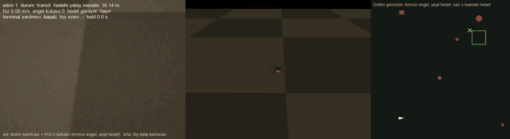

# Ebabil MuJoCo

MuJoCo ve PPO kullanarak bir quadrotorun 3B ortamda engellerden kaçıp hedefe ulaşmasını araştıran simülasyon projesi.

## Demo



Sol panel drone kamerası ve YOLO11n kutuları (kırmızı engel, yeşil hedef),
orta panel dış takip kamerası, sağ panel üstten harita (mavi rota, sarı x
inanılan hedef). Episode 389. adımda `hover_success` ile biter. Tam
çözünürlüklü video: [docs/media/demo_hover_bright.mp4](docs/media/demo_hover_bright.mp4);
kaynak koşu ve yeniden üretme komutu: [docs/media/README.md](docs/media/README.md).
Simülasyon kaydıdır; gerçek uçuş güvenliği iddiası taşımaz.

## Kurulum

Sıfırdan kurulum, test, ilk çalıştırma ve eğitim zincirinin adım adım
anlatımı: [Türkçe kurulum belgesi](docs/KURULUM.md) /
[English getting-started guide](docs/GETTING_STARTED.md). Kısa hâli:

```bash
python3.13 -m venv .venv
.venv/bin/python -m pip install --upgrade pip
.venv/bin/python -m pip install -r requirements.lock
.venv/bin/python -m pip install --no-build-isolation -e .
.venv/bin/python -m pytest -q        # beklenen: 382 passed
```

Onaylı YOLO11n dedektör ve en iyi PPO politikası depoda `runs/` altında
gelir (~8 MB); demo ve değerlendirme klondan hemen sonra çalışır. Dataset'ler,
ara checkpoint'ler ve diğer koşular Git dışıdır; yerleşim ve yeniden üretim
kurulum belgesinin §7 bölümündedir.

## Güncel durum

- Proje tasarımı ve literatür incelemesi tamamlandı.
- Proje-yerel Python ortamı `.venv` içinde kuruldu.
- MuJoCo 3.13.0 ve RL çekirdek bağımlılıkları doğrulandı.
- Faz 1 quadrotor MJCF modeli ve dokuz otomatik model/fizik testi tamamlandı.
- Faz 2 mixer, rotor gecikmesi, thrust eğrisi, gövde sürüklemesi ve rüzgâr arayüzü tamamlandı.
- Faz 3 kademeli klasik uçuş kontrolü ve `100/100` seed'li nominal başlangıç doğrulaması tamamlandı.
- Faz 4 planar rangefinder, sensör hata modeli ve seed tabanlı statik sahne
  baseline'ı tamamlandı; rangefinder artık yalnız legacy/privileged araçtır.
- Faz 5 `EbabilNavigation-v0` Gymnasium ortamı ve 30 elemanlı observation v1
  legacy simülasyon baseline'ı olarak donduruldu.
- Kod/dokümantasyon review bulgularının tamamı kapatıldı; wheel, seed, 3B rota,
  perception provenance ve bağımsız audit kapıları doğrulandı.
- Eğitim/test altyapısı headless; seçilmiş koşular ayrı MuJoCo viewer'da oynatılır.
- Faz 6 PPO eğitim/checkpoint/evaluation/replay altyapısı tamamlandı.
- Faz 6 held-out manifest, baseline ve çoklu-seed kalite runner'ı tamamlandı.
- `20260910` seed'li 100k pilot held-out `20/20` başarıyla tamamlandı.
- Hedef donanım IMX477 12MP motorized-focus kamera + Pixhawk 2.4.8 + Waveshare Jetson
  Orin NX AI Kit 8GB olarak kesinleşti; GPS/GNSS ve LiDAR/rangefinder olmayacak.
- Terminal görev hedef bölgenin güvenli iç alanı üzerinde kararlı hover ve
  kesintisiz hold olarak kesinleşti; hedefe çarpma başarı değildir.
- Büyük haritalar yerel PPO segmentleri ve rota temelli dinamik zaman bütçesiyle
  ele alınacak; kilometre görevi kesintisiz mission evaluation olacaktır.
- Faz 6.5 parametrik IMX477 kamera, `2 x 2 m` hedef alan, headless
  RGB/depth/segmentation capture, projection ve marker-leakage testleri
  tamamlandı.
- Seed bazında ayrık actor/privileged vision dataset üreticisi, geniş görsel
  domain randomization, küçük CNN, leakage denetimi ve çoklu-seed kalite akışı
  tamamlandı.
- `vision-dataset-v4`, `512/64/64/96`
  train/validation/development-OOD/audit kaydı, hedef-renk distractor'ları ve
  çoklu engel primitive'leri kullanır. `vision-encoder-v9` üç-seed geliştirme
  kapısını ve yeni salt'lı, train-dışı ellipsoid audit'i geçti.
- Fail-closed quality/audit akışı, göreli artefact yolları ve SHA-256 provenance
  zinciri tamamlandı. Onaylı model yalnız audit approval manifest'i üzerinden
  yüklenebilir.
- `EbabilVisionNavigation-v0`, deploy edilebilir `vision-v1` Dict observation,
  ileri/dikey/yaw action, `30/20/500 Hz` kamera-policy-fizik scheduler'ı ve
  rota-temelli dinamik segment horizon'ıyla tamamlandı. Gerçek renderer üzerinde
  checker, random-policy, kısa PPO ve deterministic evaluation smoke geçti.
- Terminal hover öncesi inceleme tamamlandı: hedef merkezi hover pozunda
  kamera kadrajı dışındadır (nadir eşiği `60.08 derece`), hedef hover hacmi
  sahne üretiminde engelsizdir ve hover irtifa bandı fail-fast doğrulanır.
- Terminal hover durum makinesi tamamlandı: `transit -> acquired -> approach ->
  settle -> hold -> success`, `target_score` histerezisli görsel kapılar,
  target-loss/stale-frame abort'u ve on bir ayrık reward bileşeni. Başarı
  privileged ground truth ile doğrulanır; çarpışma hiçbir koşulda başarı
  değildir. `vision-v1` observation sözleşmesi değişmemiştir.
- `vision-dataset-v4c` rastgele rota geometrisi ve hover zarfından örneklenen
  hold pozu ailesiyle üretildi; hold pozlarında hedef `%88-93` görünür fakat
  alanı yarısı kadardır.
- Bu dağılımda onaylanabilir encoder üretilemedi: risk kanalı altı kalite
  kapısını birlikte geçemedi (REV-021, açık). Onaylı zincir değişmedi
  (`vision-encoder-v9`) ve audit split'i tüketilmedi. REV-021, ADR-010
  merdiveninde D2 (değişken endpoint) ve sonrasını bloke eder; D0-V sabit legacy
  geometri olduğu için etkilenmez.
- **D0-V tamamlandı:** kamera + telemetri girdisiyle eğitilen PPO politikası
  terminal hover görevini öğrendi. `best` checkpoint deterministik
  evaluation'da `20/20` `hover_success`, sıfır çarpışma, sıfır abort.
  Bu koşuda **engel yoktur** ve sahne sabittir; engelden kaçınma henüz
  eğitilmedi. Ayrıntı: [Faz 7 D0-V kaydı](docs/PHASE_7_D0V_VISION_POLICY.md).
- Uygulanabilir hold bandı `0.108 m` ölçüldü ve başarı `3.6 cm` konum farkıyla
  belirleniyor (REV-023, açık); deterministik ve stokastik evaluation bu görevde
  birbirinin yerine kullanılamaz.
- Görev kapsamı sadeleştirildi: her episode'un **tek** hedef noktası vardır,
  ara waypoint yoktur. Mission segment manager ve çoklu waypoint plandan
  çıkarıldı (ADR-018).
- Ölçek merdiveni D1-D5 olarak yeniden tanımlandı. Seyir hızı algı menziliyle
  sınırlı (`6 m/s`); D5 eğitim değil kompozisyon evaluation rejimidir.
- Hedefin yalnız **yaklaşık** konumu bilinir (ADR-019): araç kendi konumunu
  hatasız bilir (görsel pozisyonlama varsayımı), hedefin gerçek konumunu hiçbir
  zaman öğrenmez. Bu kamerayı yer bulma işine dahil eder ve `search` durumunu
  zorunlu kılar.
- D1 ölçek dilimi (12-14 Eylül 2026): `20 x 20 m` workspace, `R = 2 m`
  yaklaşık hedef, `search` durumu ve engel ekseni açıldı. Dokuz engelli koşu
  `%0` başarı verdi; REV-039..046 düzeltmeleri kendi ekseninde çalıştı fakat
  beş hover koşulu birlikte hiç sağlanmadı (REV-043).
- **Yön değişikliği (26 Eylül 2026, ADR-023):** kullanıcı kararıyla algı iki
  modele ayrıldı: YOLO11n dedektör (hedef/engel kutuları, simülatörün otomatik
  kutu etiketleriyle eğitilir, onay zincirinden geçer) + PPO politikası
  (`vision-v4`: `9 x 8` kutu yuvası + `fc_state` + yaklaşık `waypoint` +
  `timing`, `88` boyut; `EbabilVisionNavigation-v2`). Politika engel/hedef
  koordinatı görmez; hover kapısı dedektörün hedef kutusudur; dedektör eğitim
  döngüsünün içindedir. ADR-022 zinciri baseline olarak korunur; Dilim 3
  eğitimi `528k` adımda iptal edildi. **29 Eylül 2026:** dedektör zinciri ve `v2` ortamı tamam; YOLO11n geliştirme kapılarını geçti, audit'in elipsoit engellerinde geçmedi (REV-050) ve kullanıcı kararıyla eğitim şekilleriyle sınırlı onaylandı. **30 Eylül 2026:** ADR-024 (baktığın yöne uç), ADR-025 (terminal hover yardımcısı) ve ADR-017 R1 ile üç seed held-out ortalaması hover başarısı `%84`, arrival `%84`, çarpışma `%13` (projede ilk başarılı hover'lar; çarpışma kapısı `<= %10` henüz geçilmedi). Demo videoları `runs/demo_20260930/`.
- **Yön değişikliği (22 Eylül 2026, ADR-022):** actor algısı simülatör
  depth/segmentation etiketleriyle eğitilmiş encoder'dan gelmeyecek. Birinci
  kademe yalnız actor RGB'siyle eğitilen donmuş VAE kodlayıcı, latent
  düzeyinde `k = 4` yığın, ortam içi görsel domain randomization ve
  `vision-v3` observation sözleşmesi (`EbabilVisionNavigation-v1`); ikinci
  kademe kodlayıcının PPO içinde ince ayarı. Etiketli `v11` zinciri legacy
  karşılaştırma baseline'ıdır. Plan: `docs/IMPLEMENTATION_PLAN.md` §23.
- **Dilim 1 (22 Eylül 2026):** etiketsiz VAE zinciri kodlandı ve ölçüldü
  (`scripts/train_visual_vae.py`, `run_vae_quality.py`, `run_vae_audit.py`).
  Üç seed kalite koşusu sabit eşikli hedef recall kapısında takıldı; 11
  varyantlık etiketsiz tarama geçiremedi (REV-049). Kullanıcı kararıyla
  ADR-022 Revizyon 1: eşikten bağımsız hedef kapısı (AUROC/AP), en iyi
  eşikte harita IoU, latent 128. İkinci kalite koşusu: `runs/vae_quality_v2_20260922`: eşikten bağımsız kapıların hepsi üç seed'de geçti (AUROC `0.81-0.82`, en iyi eşikte harita IoU `0.50-0.54`); korunan sabit `0.5` eşiğindeki harita IoU iki seed'de `0.25-0.28` (kapı `0.30`), `quality_passed = False`. Kullanıcının 23 Eylül onayıyla Revizyon 1b: bu kapı kaldırıldı; üçüncü kalite koşusu ve audit geçti, onaylı kodlayıcı `runs/vae_audit_v1_20260923/approval_manifest.json`. **Dilim 2 (23 Eylül 2026):** `EbabilVisionNavigation-v1` / `vision-v3`, ortam içi görsel randomization ve privileged görünürlük kapısı tamam; throughput `0.76 x v0`. Sırada Dilim 3 (D1a eğitimi, 3 seed).

Güncel ve ayrıntılı durum için [ilerleme günlüğüne](docs/PROGRESS_LOG.md) bakın.

## Hızlı başlangıç

```bash
source .venv/bin/activate
python scripts/inspect_model.py
python scripts/run_hover_demo.py
python scripts/smoke_navigation_env.py --mode clear
python scripts/train_ppo.py --smoke --device cpu --run-name ppo-smoke
python scripts/train_ppo.py \
  --config src/ebabil/configs/training/ppo_vision_d0v.toml \
  --device cpu --run-name d0v-seed20260911
python scripts/run_phase6_experiment.py --smoke --device cpu \
  --output-dir runs/phase6-smoke
python -m pytest -q
ruff check src scripts tests
ruff format --check src scripts tests
mypy
```

macOS'ta viewer:

```bash
scripts/run_mjpython.sh scripts/view_hover_demo.py --loop
scripts/run_mjpython.sh scripts/view_static_scene.py --mode single_blocker --seed 20260910
scripts/run_mjpython.sh scripts/view_policy_replay.py \
  runs/<run-name>/held-out/replays/episode_000.npz --loop
scripts/run_mjpython.sh scripts/view_target_camera.py --pose hover --camera overview
scripts/run_mjpython.sh scripts/view_target_camera.py --pose hover --camera onboard
```

Kamera geometri/capture smoke kontrolleri:

```bash
.venv/bin/python scripts/sweep_camera_visibility.py
.venv/bin/python scripts/sweep_camera_visibility.py --require-hold-center
.venv/bin/python scripts/capture_camera_frame.py --pose start --dry-run
.venv/bin/python scripts/capture_camera_frame.py --pose hover --dry-run
```

`--require-hold-center`, hedef merkezinin hover pozunda da kadrajda olmasını
kapıya dahil eder. Mevcut `45 derece` montajda bu kapı bilinçli olarak
geçilmez; gerekçe ve karar ADR-016 içindedir.

Vision dataset ve encoder smoke akışı:

```bash
.venv/bin/python scripts/generate_vision_dataset.py \
  runs/vision-dataset-smoke --scenes-per-split 1 --samples-per-scene 2
.venv/bin/python scripts/train_vision_encoder.py \
  runs/vision-dataset-smoke runs/vision-encoder-smoke --epochs 1 --batch-size 2
```

Tam görsel dataset ve üç-seed kalite akışı:

```bash
.venv/bin/python scripts/generate_vision_dataset.py runs/vision_dataset_v4c
.venv/bin/python scripts/run_vision_quality.py \
  runs/vision_dataset_v4c runs/vision_quality
.venv/bin/python scripts/run_vision_audit.py \
  runs/vision_dataset_v4c runs/vision_quality/quality_report.json runs/vision_audit
```

Vision environment ve PPO smoke:

```bash
.venv/bin/python scripts/smoke_vision_navigation_env.py \
  runs/vision_audit_v2_20260911/approval_manifest.json \
  --mode random_obstacles --random-steps 100 \
  --ppo-timesteps 64 --evaluation-steps 80
```

Proje yolunda boşluk bulunduğu için viewer komutları doğrudan `.venv/bin/mjpython` yerine bu wrapper üzerinden çalıştırılır.

Sanal ortam yoksa yukarıdaki "Kurulum" bölümü veya
[docs/KURULUM.md](docs/KURULUM.md) izlenir.

## Belgeler

- [Sıfırdan kurulum ve ilk çalıştırma (Türkçe)](docs/KURULUM.md)
- [Getting started from scratch (English)](docs/GETTING_STARTED.md)
- [Demo medyası ve kaynağı](docs/media/README.md)
- [Unreal Engine + ROS entegrasyonu (politikayı dağıtma)](docs/UNREAL_ROS_ENTEGRASYON.md)
- [Proje tasarımı](docs/PROJECT_DESIGN.md)
- [Literatür incelemesi](docs/LITERATURE_REVIEW.md)
- [Implementasyon planı](docs/IMPLEMENTATION_PLAN.md)
- [İlerleme günlüğü](docs/PROGRESS_LOG.md)
- [Kod ve dokümantasyon review bulguları](docs/REVIEW_FINDINGS.md)
- [Faz 6 PPO baseline çalışma kaydı](docs/PHASE_6_PPO_BASELINE.md)
- [Faz 6.5 kamera ve hedef alan çalışma kaydı](docs/PHASE_6_5_CAMERA_TARGET.md)
- [Faz 6.5 vision dataset ve encoder çalışma kaydı](docs/PHASE_6_5_VISION_DATASET_ENCODER.md)
- [Faz 6.5 vision navigation environment kaydı](docs/PHASE_6_5_VISION_NAVIGATION_ENV.md)
- [Faz 7 terminal hover çalışma kaydı](docs/PHASE_7_TERMINAL_HOVER.md)
- [Faz 7 D0-V vision politika kaydı](docs/PHASE_7_D0V_VISION_POLICY.md)
- [Faz 7 D1 kanıt koşusu](docs/PHASE_7_D1_EVIDENCE_RUN.md)
- [İlerleme raporu, 23 Eylül 2026](docs/reports/2026-09-23-ilerleme-raporu.md)
- [RL sistemi ve CNN yapısı raporu](docs/reports/2026-09-23-rl-sistemi-ve-cnn-yapisi.md)
- [RL sistemi raporu (vision-v4, YOLO + PPO), 30 Eylül 2026, Word](docs/reports/2026-09-30-rl-sistemi-raporu.docx)
- [Sistem mimarisi diyagramı, 1 Ekim 2026, PNG](docs/reports/2026-10-01-sistem-mimarisi.png)
- [Kamera/Pixhawk/Jetson mimari kararı](docs/decisions/ADR-011-camera-only-pixhawk-jetson-architecture.md)
- [Güvenli terminal görev kapsamı](docs/decisions/ADR-012-safe-terminal-mission-scope.md)
- [Segmentli episode ve zaman bütçesi](docs/decisions/ADR-013-segmented-episodes-and-time-budget.md)
- [Vision dataset, quality ve audit sözleşmesi](docs/decisions/ADR-014-vision-dataset-quality-and-audit-contract.md)
- [Vision navigation ve observation sözleşmesi](docs/decisions/ADR-015-vision-navigation-contract-v1.md)
- [Hover geometrisi ve hedef açıklığı](docs/decisions/ADR-016-hover-geometry-and-target-clearance.md)
- [Terminal hover durum makinesi ve reward](docs/decisions/ADR-017-terminal-hover-state-machine-and-reward.md)
- [Tek hedefli ölçek merdiveni ve algı-hız kısıtı](docs/decisions/ADR-018-single-target-scaling-ladder.md)
- [Yaklaşık hedef konumu ve görsel arama](docs/decisions/ADR-019-approximate-target-and-visual-search.md)
- [Holonomik action sözleşmesi](docs/decisions/ADR-020-holonomic-action-contract.md)
- [Observation sözleşmesi vision-v2](docs/decisions/ADR-021-observation-contract-v2.md)
- [Etiketsiz görsel temsil ve vision-v3](docs/decisions/ADR-022-label-free-visual-representation.md)
- [İki modelli algı: YOLO dedektör + RL politikası, vision-v4](docs/decisions/ADR-023-detector-policy-two-model-perception.md)
- [Kamera konisi hareket kısıtı, vision-action-v3](docs/decisions/ADR-024-camera-cone-motion-constraint.md)
- [Terminal hover yardımcısı](docs/decisions/ADR-025-terminal-hover-assist.md)
- [Mimari kararlar](docs/decisions/)
- [Agent çalışma protokolü](AGENTS.md)

## Temel koordinat sistemi

- MuJoCo dünya çerçevesi sağ elli ve `+z` yukarıdır.
- Başlangıç gövde çerçevesi FLU olarak yorumlanır: `+x` ileri, `+y` sol, `+z` yukarı.
- Pozitif roll/pitch/yaw sağ el kuralını izler.

Bu kuralların ayrıntıları [ADR-001](docs/decisions/ADR-001-control-and-frames.md) içinde tutulur.
